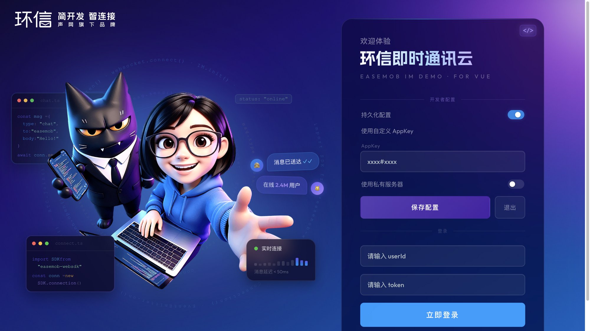
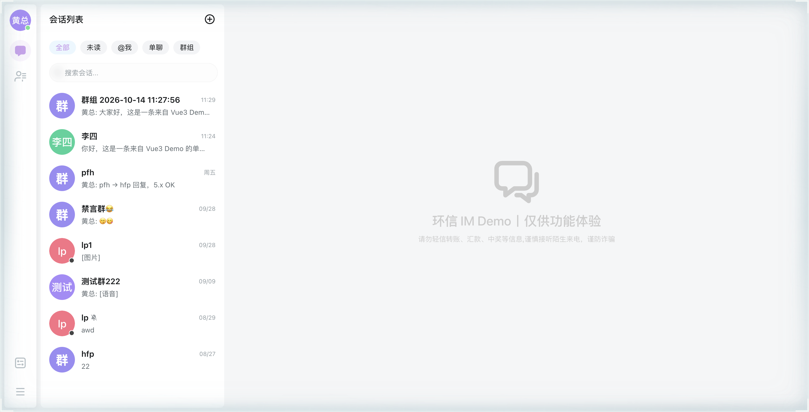
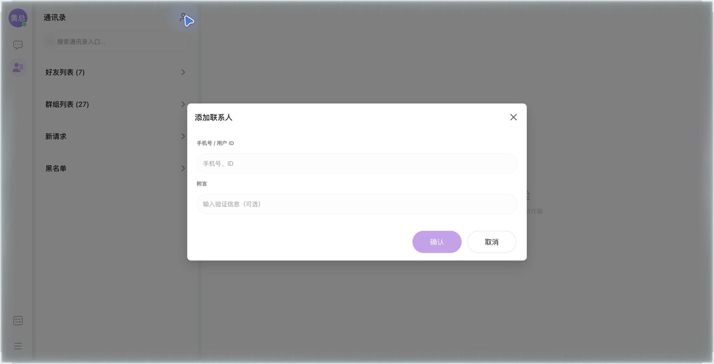
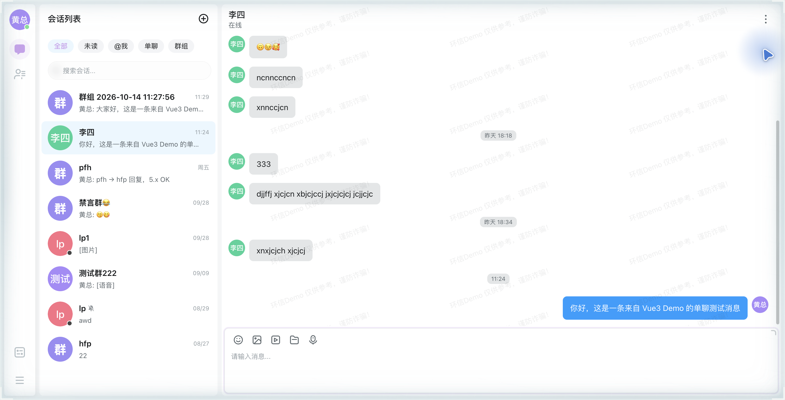
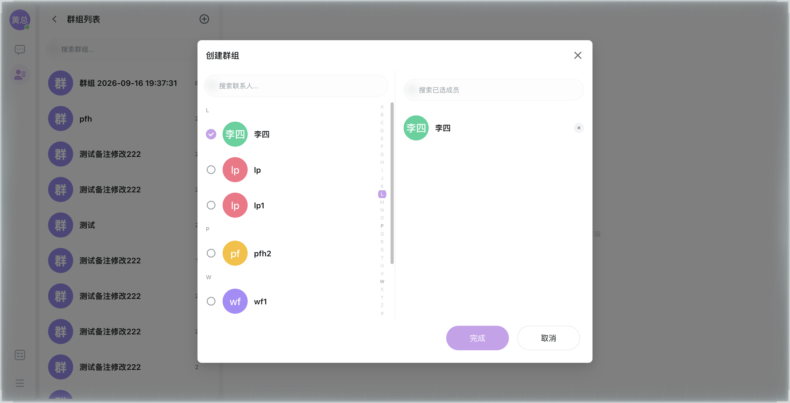
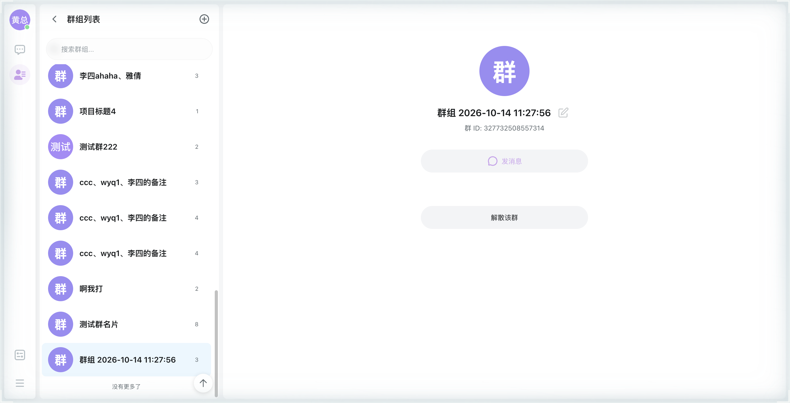
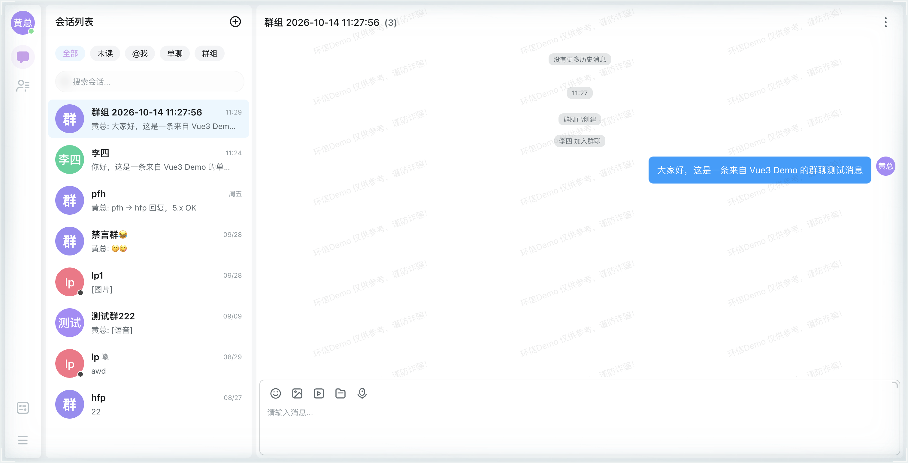

# 接入步骤

本文档帮助你在本地跑通 `easemob-demo-vue3`（环信 IM Vue3 Demo），并完成「发送一条单聊消息」「创建群组并发送群聊消息」两个核心体验。全程约 10 分钟。

## 环境要求

- Node.js >= 20.19
- pnpm 10+

可先执行以下命令确认版本：

```bash
node -v   # 应输出 v20.19.0 或更高
pnpm -v   # 应输出 10.x
```

## 前置准备

1. 前往 [环信控制台](https://console.easemob.com) 注册账号并创建应用；
2. 在应用详情页获取 **AppKey**（格式为 `orgName#appName`，例如 `1111222233334444#demo`）；
3. 在「用户管理」→ **创建 2 个用户**（设置用户 ID 与密码）。单聊需要两个账号互发消息，建议记为「用户 A」「用户 B」。

## 获取 Demo

```bash
git clone https://github.com/Easemob-Community/easemob-demo-vue3.git
cd easemob-demo-vue3
```

## 安装并运行

```bash
pnpm install   # 安装依赖
pnpm dev       # 启动开发服务器（默认 5173 端口，被占用时自动顺延到 5174 等）
```

启动成功后，浏览器打开终端输出的地址（默认 `http://localhost:5173`），即可看到登录页。开发模式下登录表单右上角的 `</>` 开发者面板默认展开，可在其中配置 AppKey 并以 userId + token 方式登录：



## 发送一条单聊消息

1. **配置 AppKey**（二选一，优先级：开发者面板 > 环境变量）：
   - 在登录页 `</>` 开发者面板的「开发者配置」中填入你的 AppKey，点击「保存配置」（配置写入 localStorage 后页面自动刷新生效）；
   - 或在项目根目录 `.env.development` 中追加 `VITE_APP_KEY=你的orgName#你的appName`，然后重启 `pnpm dev`。
2. **登录用户 A**：在开发者面板的登录表单中填入用户 A 的 `userId` 与 `token`（token 获取方式见「常见问题」），点击「立即登录」，进入会话页：

   

3. **添加用户 B 为好友**：切换到「通讯录」页，点击右上角「添加好友」图标，在弹窗中输入用户 B 的用户 ID（或手机号），可同时填写附言，点击「确认」发送好友申请；用用户 B 登录（可开浏览器无痕窗口）在「新请求」中同意申请：

   

4. **发送消息**：回到用户 A 的会话列表，打开与用户 B 的单聊会话，在输入框输入文本并回车发送；用户 B 侧可实时收到：

   

## 创建群组并发送群聊消息

1. 在「通讯录」页进入「群组列表」，点击右上角 `+` 打开「创建群组」弹窗；
2. 在弹窗左侧勾选群成员（如用户 B），右侧确认已选成员后点击「完成」创建（Demo 会以「群组 + 创建时间」自动命名）：

   

3. 创建完成后，在群组列表中打开该群的详情页，点击「发消息」进入群聊会话：

   

4. 在输入框输入文本并回车发送，群成员可实时收到群消息：

   

## 常见问题

**Q1：换成自己的 AppKey 后，为什么「手机号 + 短信验证码」登录不可用？**

该登录链路依赖环信官方 Demo 的 App Server 与官方短信服务，只服务于官方 Demo 的 AppKey。换成自己的 AppKey 后请使用开发者模式的 userId + token 登录；如需保留手机号验证码登录体验，需自建 App Server（接口清单见 [`docs/prod-server-apis.md`](../prod-server-apis.md)）。

**Q2：登录用的 token 从哪里获取？**

通过环信服务端 REST API 用「用户 ID + 密码」换取（见[环信文档中心](https://docs.easemob.com)「获取用户 token」），token 通常以 `YWMt` 开头。换取 token 需要 App 的 `client_id` / `client_secret`，请在服务端或本地脚本中调用，切勿把 AppSecret 写进前端代码。

**Q3：启动时提示 5173 端口被占用怎么办？**

Vite 会自动顺延到下一个可用端口（如 5174），以终端实际输出的地址为准；也可以杀掉占用 5173 的进程后重新启动。

**Q4：改了代码 / 升级依赖后页面没有变化？**

可能是 Vite 预打包缓存未刷新。本项目 `vite.config.ts` 已内置检测（uikit 产物更新时自动清缓存），兜底可手动执行 `rm -rf node_modules/.vite` 后重启 `pnpm dev`。

**Q5：AppSecret 可以放在前端代码里吗？**

不可以。AppSecret 具备应用最高权限，泄露会导致应用被恶意操作。注册用户、获取 token 等需要 AppSecret 的操作只能在服务端完成，再由服务端把 userId / token 下发给前端。
